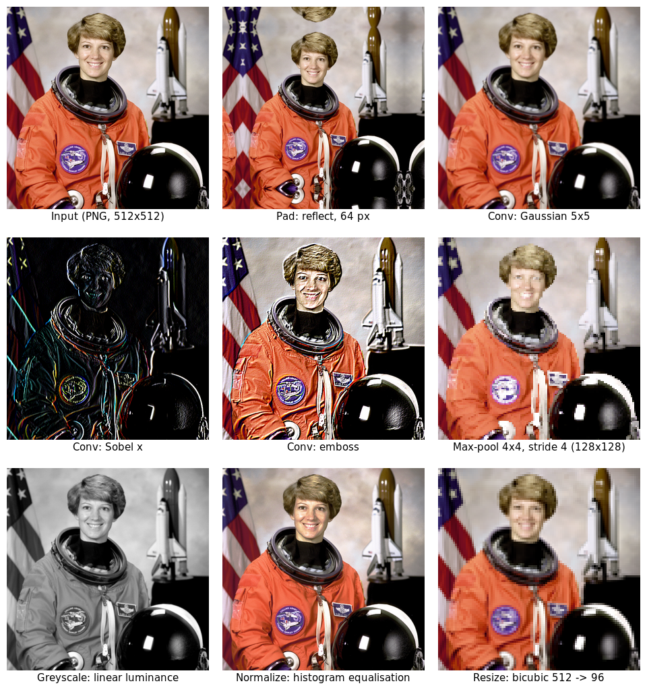
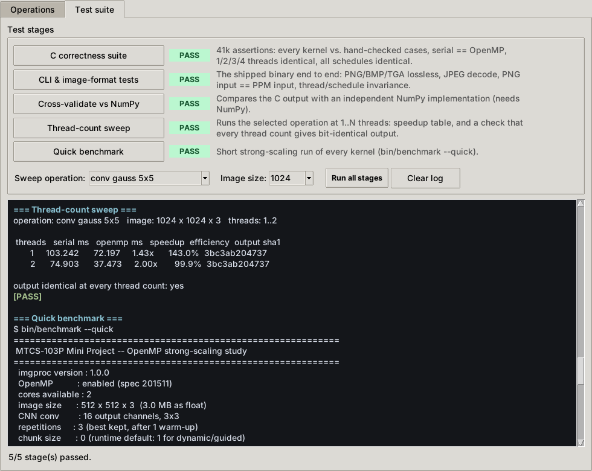

# Parallel Image Processing and CNN Primitives with OpenMP

[](https://github.com/buvann-11/Parallel-Image-Processing-OpenMP/actions/workflows/ci.yml)


**MTCS-103P — High Performance Computing Laboratory · Mini Project (P1: Image Processing 2)**
Sri Sathya Sai Institute of Higher Learning

CNN padding, convolution and pooling, plus greyscale conversion, normalisation and
resizing — implemented from scratch in C99, parallelised with OpenMP, verified
against an independent implementation, race-checked, and measured.

| Registration no. | Name | Contribution |
|---|---|---|
| 26010303001 | B. Sai Buvann | Part 1 — padding, convolution, pooling; OpenMP strategy and false-sharing analysis; C test suite |
| 26010303004 | M. Sai Praneeth | Part 2 — greyscale, normalisation, resize; benchmark harness and scaling study; GUI; report |

📄 **Report:** [`report/REPORT.md`](report/REPORT.md) · [`report/REPORT.pdf`](report/REPORT.pdf)



---

## At a glance

| | |
|---|---|
| Language | C99 + OpenMP; image codecs from the vendored, public-domain [stb](https://github.com/nothings/stb) headers |
| Operations | 9, each with a directive-free serial baseline *and* an OpenMP version |
| Image formats | PPM/PGM natively; PNG, JPEG, BMP, TGA via stb |
| Correctness | 27 C tests (**41,119 assertions**) + 16 end-to-end CLI checks, all passing |
| Cross-validation | **20/20** checks against an independent NumPy implementation, most bit-exact |
| Race freedom | ThreadSanitizer + Archer: **no races**; output bit-identical at every thread count and schedule |
| Memory safety | AddressSanitizer + UBSan: clean |
| Build | zero warnings at `-Wall -Wextra -Wpedantic -Wshadow -Wstrict-prototypes`, GCC and clang |
| CI | GitHub Actions on Linux (GCC) and macOS (Apple clang + libomp) |
| GUI | Tkinter, standard library only: run operations, and run every test stage with one click |

---

## Quick start

```bash
make            # build everything
make test       # C correctness suite + CLI / image-format tests
make gui        # graphical front-end
make check      # everything CI runs: tests, NumPy verify, ASan, TSan
```

**Linux:** any recent GCC — nothing else.
**macOS:** `brew install libomp`, then `make` (Apple clang is detected and given the
right OpenMP flags automatically), or `brew install gcc` and `make CC=gcc-14`.

Python 3.8+ with Tkinter is needed only for the GUI; NumPy only for `make verify`;
Matplotlib only for the figures. `make tsan` needs clang, libomp and the clang
TSan runtime (Ubuntu: `apt install clang libomp-dev libclang-rt-dev`).

---

## Graphical interface

The assignment asks for "a minimal GUI for running various tests on the submitted
code". `make gui` opens two tabs.

**Operations** — load any image, choose operation, variant, thread count and
schedule, and compare serial vs OpenMP time side by side with the result:


**Test suite** — one click per stage (C suite, CLI/format tests, NumPy
cross-validation, thread-count sweep with output hashing, quick benchmark), each
with a live PASS/FAIL badge and streamed output:



---

## What is implemented

### Part 1 — CNN primitives

| Operation | Capability |
|---|---|
| **Padding** | `zeros`, `reflect`, `replicate`, `circular`; arbitrary width, including wider than the axis itself (which `numpy.pad` refuses) |
| **Convolution** | Batched multi-channel `(N,C,H,W)`, stride, dilation, bias; direct loop nest, vectorised inner loop |
| **Pooling** | Max and average with stride and padding, plus global average pooling |
| **Image filtering** | Depthwise (per-channel) filtering with box, Gaussian, Sobel, Laplacian, sharpen and emboss kernels |

### Part 2 — Image processing

| Operation | Capability |
|---|---|
| **Greyscale** | ITU-R BT.601, BT.709, arithmetic mean, and true relative luminance with sRGB gamma linearisation |
| **Normalisation** | Min–max, z-score, histogram equalisation |
| **Resize** | Nearest, bilinear, bicubic (Keys *a* = −0.5); separable two-pass; correct anti-aliasing on downscale |

---

## Command line

```bash
./bin/imgproc info                          # build configuration, thread count
./bin/imgproc gen input.ppm --size 1024     # generate a test image

./bin/imgproc grayscale photo.jpg grey.png   --method bt709
./bin/imgproc normalize photo.png out.png    --method equalize
./bin/imgproc resize    photo.png small.png  --size 256 256 --method bicubic
./bin/imgproc pad       photo.png padded.png --amount 32 --mode reflect
./bin/imgproc pool      photo.png pooled.png --type max --size 2 --stride 2
./bin/imgproc conv      photo.png edges.png  --kernel sobelx
./bin/imgproc convert   photo.jpg photo.ppm                 # format conversion only
```

The format is chosen from the file extension (`.ppm .pgm .png .jpg .jpeg .bmp .tga`).
Every operation runs **both** the serial and the OpenMP version and reports the
measured speedup:

```
  operation : conv (sobelx 3x3)
  output    : 1024 x 1024 x 3
  serial    :   27.949 ms
  openmp    :   12.940 ms   (2 threads)
  speedup   :     2.16x
  efficiency:   108.0%
```

Common options: `--threads N`, `--schedule static|dynamic|guided`, `--repeat N`,
`--json`, `--quiet`.

---

## Verifying correctness

```bash
make test       # 27 C tests (41,119 assertions) + 16 CLI / image-format checks
make verify     # cross-check against the NumPy reference (needs NumPy)
make serial     # build with OpenMP disabled, as a control
make asan       # AddressSanitizer + UndefinedBehaviorSanitizer
make tsan       # ThreadSanitizer + Archer: OpenMP data-race detection
```

The tests that matter most for a *parallel* project:

- **Output is bit-identical at 1, 2, 3 and 4 threads**, and **under `static`,
  `dynamic` and `guided`**. A data race almost never crashes — it quietly changes a
  few pixels, often only at some thread counts. Demanding identical output is the
  practical way to catch one; `tests/test_cli.sh` repeats the check end to end on
  the shipped binary.
- **OpenMP output is identical to serial output** — exactly, not approximately.
- **ThreadSanitizer finds no races.** With GCC's libgomp, TSan cannot see OpenMP's
  barriers and reports false races everywhere, so `make tsan` uses clang + LLVM
  libomp with **Archer**, LLVM's OpenMP-aware TSan tool.

`make verify` compares the C output against `reference/imgproc`, a separate NumPy
implementation of the same operations (itself validated against SciPy, Pillow,
OpenCV and scikit-image). This caught a real bug: nearest-neighbour downscaling
disagreed on ~0.6 % of pixels because `floorf` in `float32` landed on the wrong
side of an integer boundary for ratios like 256/97. Self-consistent testing would
never have found it.

---

## Reproducing the performance results

```bash
make results    # scaling study + chunk-size experiment + all figures + PDF
```

The harness detects the core count and sweeps powers of two up to it. The numbers
in the report were measured on a 2-core machine; see §5 of the report.

---

## Three findings worth knowing

**1. Arithmetic intensity predicts scalability.** The kernels that scale near
ideally — convolution, gamma-corrected greyscale — are exactly the ones doing many
operations per byte loaded. Bandwidth-bound kernels (padding, pooling, plain
greyscale) hit the memory bus first. This is predictable from the code before
measuring anything.

**2. Chunk size is not a detail.** `schedule(dynamic)` with OpenMP's default chunk
of **1** made greyscale **100× slower** — every single pixel went through the
runtime's dispatch path. An oversized chunk of 8192 made the row-based kernels 2×
slower instead, because a 1024-row image has only ~1000 iterations to give out.
There is no universally right chunk size; it has to match the granularity of the
loop body.

**3. Suspicious results deserve investigation, including the flattering ones.** An
early version reported 15× speedup on 2 cores. That was a methodology bug: the
"serial" baseline used `#pragma omp parallel for ... if(0)`, and GCC still emits
the full libgomp loop protocol when the condition is false — inflating every
speedup roughly 7×. Both that and the remaining superlinear results are documented
in §5.6 of the report rather than quietly kept.

---

## Design notes

- **Row ownership.** Each parallel iteration owns one output row exclusively, so
  the project contains no atomics, no critical sections, and exactly one barrier
  (between the resize's two passes).
- **False sharing designed out, not debugged out.** All buffers are 64-byte
  aligned; per-thread histograms are padded to whole cache lines.
- **`collapse(3)`** over (batch, channel, row), so the work divides evenly even for
  a single one-channel image.
- **Honest baselines.** `<op>_serial()` contains no OpenMP directives at all —
  not the parallel version run with one thread.
- **No `-ffast-math`.** It would let the compiler reassociate floating-point sums,
  changing results between thread counts and undermining the correctness
  comparison.
- **Third-party code is quarantined.** stb is compiled in a single translation
  unit with relaxed warnings; no third-party code is used in any kernel.

---

## Repository layout

```
.
├── include/imgproc.h            public API, layout and parallelisation contract
├── src/                         the library
│   ├── core.c                   aligned allocation, layout conversion, timing
│   ├── image_io.c               Netpbm reader/writer, synthetic test patterns
│   ├── image_formats.c          PNG/JPEG/BMP/TGA dispatch via stb
│   ├── padding.c                Part 1 — padding, four border modes
│   ├── convolution.c            Part 1 — convolution + depthwise image filtering
│   ├── pooling.c                Part 1 — max, average and global pooling
│   ├── grayscale.c              Part 2 — greyscale, four methods
│   ├── normalize.c              Part 2 — min-max, z-score, equalisation
│   └── resize.c                 Part 2 — separable resampling with anti-aliasing
├── cli/main.c                   command-line driver
├── gui/app.py                   Tkinter front-end (operations + test runner)
├── bench/                       strong-scaling harness and plotting
├── tests/
│   ├── test_correctness.c       27 tests, 41,119 assertions
│   ├── test_cli.sh              16 end-to-end CLI / image-format checks
│   └── tsan.supp                ThreadSanitizer suppressions (runtime only)
├── tools/                       NumPy cross-check, figures, PDF, screenshots
├── reference/imgproc/           independent NumPy oracle (verification only)
├── third_party/stb/             stb_image / stb_image_write (public domain)
├── scripts/                     demo, gallery and experiment drivers
├── report/                      REPORT.md, REPORT.pdf, figures
├── results/                     benchmark CSVs
├── data/demo/, data/samples/    sample outputs, sample photograph
├── docs/screenshots/            README images
└── .github/workflows/ci.yml     continuous integration
```

---

## License

MIT — see [`LICENSE`](LICENSE). Coursework submission for MTCS-103P.
`third_party/stb` is public domain / MIT; `data/samples/astronaut.png` is a NASA
photograph (public domain). The NumPy reference under `reference/` is included
for verification only.
