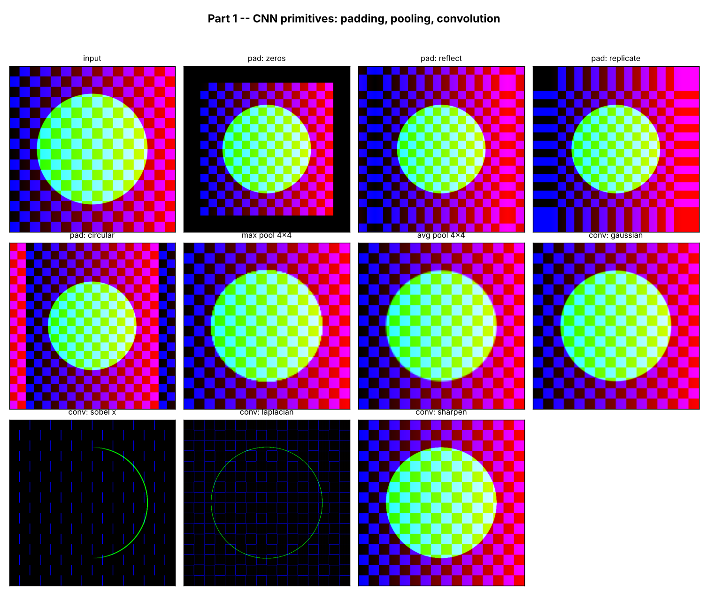
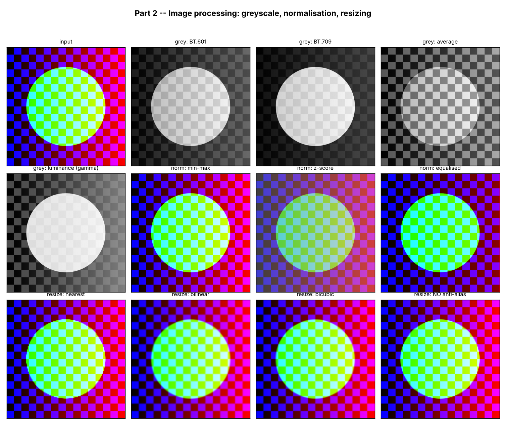
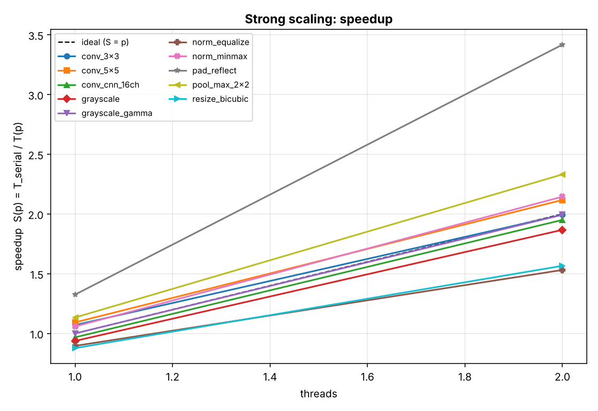
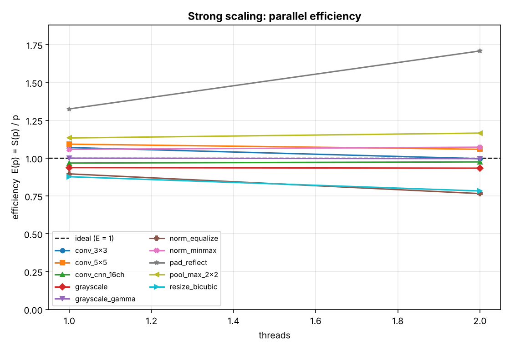
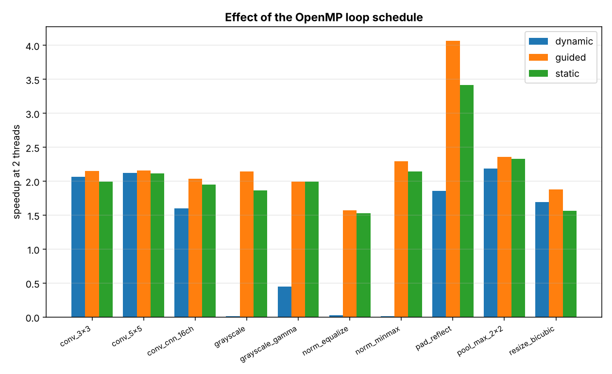
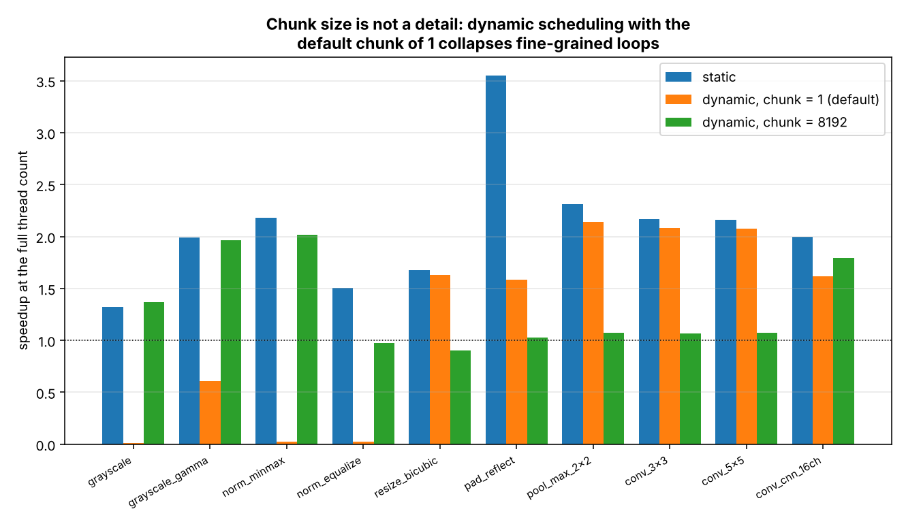
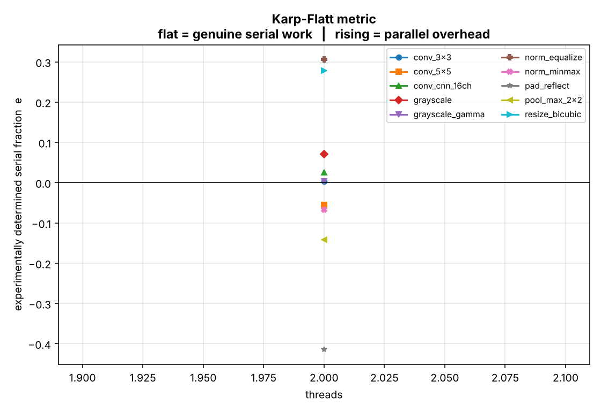
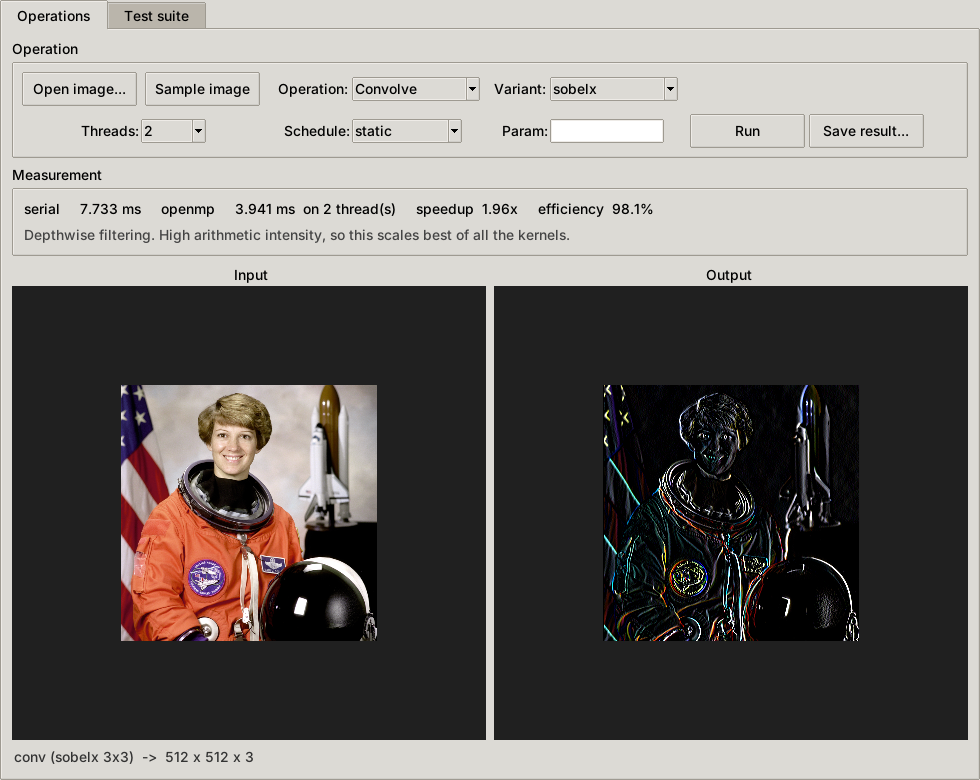

# Parallel Image Processing and CNN Primitives with OpenMP

**Mini Project Report**

**Course:** MTCS-103P — High Performance Computing Laboratory  
**Institution:** Sri Sathya Sai Institute of Higher Learning  
**Topic:** Image Processing (2) — CNN padding & pooling, and basic image processing  
**Implementation:** C99 + OpenMP, ~6,000 lines of C; every kernel written from scratch (image codecs: vendored public-domain stb)  
**Date:** 21 October 2026  
**Repository:** <https://github.com/buvann-11/Parallel-Image-Processing-OpenMP>  

---

## Team and individual contributions

| Registration no. | Name | Contribution |
|---|---|---|
| 26010303001 | B. Sai Buvann | **Part 1 — CNN primitives:** padding (four border modes), convolution and depthwise filtering, max/average/global pooling; OpenMP parallelisation strategy and false-sharing analysis; C correctness test suite |
| 26010303004 | M. Sai Praneeth | **Part 2 — image processing:** greyscale, normalisation, resize; benchmark harness and strong-scaling study; GUI front-end; report |

**Joint:** problem formulation, choice of parallelisation strategy, cross-validation
methodology, final integration and testing.

---

## Contents

1. [Objective](#1-objective)
2. [What was built](#2-what-was-built)
3. [Algorithms](#3-algorithms)
4. [Parallelisation strategy](#4-parallelisation-strategy)
5. [Experimental results](#5-experimental-results)
6. [Correctness](#6-correctness)
7. [Graphical interface](#7-graphical-interface)
8. [How to build and run](#8-how-to-build-and-run)
9. [Conclusions](#9-conclusions)
10. [Limitations and future work](#10-limitations-and-future-work)
11. [References](#11-references)

---

## 1. Objective

Convolutional neural networks are the dominant tool in image processing, and the
operations underneath them — padding, convolution, pooling — together with the
classical preprocessing steps — greyscale conversion, normalisation, resizing —
are all **data-parallel**: the same arithmetic is applied independently to
millions of pixels. They are therefore natural candidates for shared-memory
parallelisation.

This project implements all of them from first principles in C, parallelises them
with OpenMP, and measures how well each one actually scales. The emphasis is on
the second half of that sentence. Writing a correct parallel image filter is not
difficult; understanding **why one kernel reaches 2× on two cores and another
reaches only 1.5×**, and being able to predict which is which from the structure
of the code, is the actual content of the exercise.

Three questions are answered experimentally:

1. Which of these operations are compute-bound and which are memory-bound, and
   how does that determine their scalability ceiling?
2. Does the OpenMP loop schedule matter, and by how much?
3. Where does parallel efficiency go when it is lost — to genuinely serial work
   (Amdahl), or to parallel overhead?

---

## 2. What was built

| Component | Location | Lines | Purpose |
|---|---|---|---|
| Library | `src/`, `include/` | 3,043 | Nine operations, each in a serial and an OpenMP version |
| CLI driver | `cli/main.c` | 565 | Runs any operation; times serial vs parallel |
| Benchmark harness | `bench/benchmark.c` | 445 | Strong-scaling study, CSV output |
| Correctness tests | `tests/test_correctness.c` | 1,137 | 27 tests, 41,119 assertions |
| Cross-validation | `tools/verify_against_reference.py` | 323 | C output vs an independent NumPy oracle |
| Image formats | `src/image_formats.c`, `third_party/stb/` | 181 | PNG/JPEG/BMP/TGA via the stb single-header libraries |
| CLI / format tests | `tests/test_cli.sh` | 104 | End-to-end tests of the shipped binary |
| GUI | `gui/app.py` | 668 | Tkinter front-end: operations tab + one-click test runner |
| Plotting and packaging | `bench/*.py`, `tools/*.py` | 486 | Figures and PDF for this report |

**Operations implemented**

*Part 1 — CNN primitives*

- **Padding** — four border modes (`zeros`, `reflect`, `replicate`, `circular`),
  arbitrary width, including widths larger than the axis itself.
- **Convolution** — batched, multi-channel `(N,C,H,W)`, with stride, dilation and
  bias; cross-correlation semantics as in PyTorch/TensorFlow.
- **Pooling** — max and average, with stride and padding, plus global average
  pooling.
- **Depthwise image filtering** — one 2-D kernel applied per colour channel, with
  a built-in library of classical filters (box, Gaussian, Sobel, Laplacian,
  sharpen, emboss).

*Part 2 — Image processing*

- **Greyscale** — ITU-R BT.601, BT.709, arithmetic mean, and true relative
  luminance with sRGB gamma linearisation.
- **Normalisation** — min–max, z-score, and histogram equalisation.
- **Resize** — nearest, bilinear and bicubic (Keys, *a* = −0.5), separable, with
  correct anti-aliasing on downscale.

Everything is plain C99. The native image format is Netpbm (PGM/PPM), whose
entire specification is a short ASCII header followed by raw bytes. PNG, JPEG,
BMP and TGA are read and written through **stb_image / stb_image_write**
(Sean Barrett, public domain), vendored as two header files in
`third_party/stb/` — so real photographs work directly, and the evaluator still
needs nothing but a C compiler. Every decoder delivers the same float `[0,255]`
HWC layout, so a PNG and the equivalent PPM give bit-identical results (this is
tested, §6.3).

### 2.1 Output of every operation

On a photograph (PNG input, produced by `scripts/make_gallery.sh`):


On the synthetic test pattern, whose correct output can be reasoned about
exactly (produced by `make demo`; assembled with `tools/make_contact_sheets.py`):





Two details worth pointing out in the second sheet, because they are the kind of
thing that is easy to get silently wrong:

* **BT.709 is visibly brighter than BT.601** on this image, and the arithmetic
  mean is flatter than both. The disc is green, and BT.709 weights green at
  0.7152 against BT.601's 0.5870. If all three looked identical, the weights
  would not be being applied.
* **`resize: NO anti-alias`** keeps the checkerboard crisper than the
  anti-aliased versions — which looks *better* at a glance and is wrong. The
  checker period is finer than the output grid can represent, so the detail that
  survives is moiré, not signal.

---

## 3. Algorithms

### 3.1 Padding

A `k × k` convolution without padding maps an `H × W` map to
`(H−k+1) × (W−k+1)`. Two problems follow: spatial extent collapses with depth,
and a corner pixel contributes to one output while a central pixel contributes to
`k²`, so the network sees the interior far more often than the border.

For an axis of length `n`, a padded coordinate `i` maps back to a source index by
modular folding:

| Mode | Source index for coordinate `i` |
|---|---|
| `replicate` | `clip(i, 0, n−1)` |
| `circular` | `i mod n` |
| `reflect` | `m = i mod (2n−2)`; then `m` if `m < n`, else `2n−2−m` |

Folding rather than iterated reflection means a padding width **larger than the
axis** works correctly — `numpy.pad` refuses that case for `reflect`, and the test
suite exercises it (a 3-pixel axis padded by 7).

### 3.2 Convolution

```
y[n,f,p,q] = bias[f] + Σ_c Σ_i Σ_j  w[f,c,i,j] · x[n, c, p·s + i·d, q·s + j·d]
```

A **direct loop nest** is used rather than the usual `im2col` + GEMM lowering.
This is a deliberate choice for this project: `im2col` would hand the parallelism
to whatever BLAS library is linked, so the scaling study would be measuring
OpenBLAS's threading rather than our own, and the `kh·kw` memory blow-up would
distort the bandwidth analysis.

The loop order is `c → i → j → ox`, with the output column **innermost** and the
weight held constant in a register. At stride 1 the source access is unit-stride,
so GCC auto-vectorises it into fused multiply-adds. The obvious ordering — output
pixel outermost, kernel innermost — cannot vectorise, because the reduction target
would be a single scalar.

The input is padded once up front so the inner loops need no bounds checks at all.

### 3.3 Pooling

```
y_max[p,q] = max over window        y_avg[p,q] = mean over window
```

Rather than materialising a padded copy, each window is **clamped** to the real
input. This matters in three ways:

- Max pooling can never return a padded value. Feature maps contain negative
  activations, so padding with 0 would let the padding win a maximum and silently
  corrupt every border output.
- Average pooling divides by the count of *real* elements (PyTorch's
  `count_include_pad=False`), so border averages are unbiased.
- No padded buffer is allocated, saving a full pass over memory on a kernel that
  is already bandwidth-bound.

### 3.4 Greyscale

The eye is not equally sensitive to the three primaries, so a weighted sum is used:

| Standard | w_R | w_G | w_B |
|---|---|---|---|
| BT.601 | 0.2990 | 0.5870 | 0.1140 |
| BT.709 | 0.2126 | 0.7152 | 0.0722 |

Full-intensity red maps to 76 under BT.601, 54 under BT.709 and 85 under a naive
average — a 40 % spread, so the choice is not cosmetic.

A fourth method computes true relative *luminance*: sRGB values are gamma-encoded
(128 is about 21 % of the light of 255, not 50 %), so the correct procedure is to
linearise, weight, and re-encode. This turns out to be the single most useful
kernel in the scaling study, for a reason that has nothing to do with colour — see
§5.2.

### 3.5 Normalisation

All three schemes need a **global** property of the image before any output pixel
can be written, which makes this the only part of the project with a genuine
two-phase parallel structure:

| Scheme | Phase 1 (reduce) | Phase 2 (map) |
|---|---|---|
| min–max | global min and max | affine rescale |
| z-score | Σx and Σx² | affine rescale |
| equalisation | 256-bin histogram | CDF lookup table |

### 3.6 Resize

Resizing is *resampling*: each output pixel is a weighted average of nearby input
pixels, with weights from a reconstruction kernel, sampled at
`c_p = (p + 0.5)·L_in/L_out` (the half-pixel convention used by Pillow, OpenCV and
modern PyTorch).

**Anti-aliasing.** Shrinking is decimation. Sampling a 1000-pixel row at 100
positions with a one-pixel kernel reads about 10 % of the input; the rest folds
back as moiré. The fix is to widen the kernel by the downscaling factor,
`σ = max(1, L_in/L_out)`, so every input pixel contributes. Pillow has always done
this; `torch.nn.functional.interpolate` does not unless asked.

**Separability.** All three kernels are separable, so a 2-D resize is two 1-D
passes. For a `P × Q` output with `T` taps per axis the cost drops from `O(PQT²)`
to `O(PQT)` — at `T = 4` (bicubic), a 4× reduction in arithmetic before a single
thread is spawned. Worth noting explicitly in an HPC report: **that algorithmic
factor of 4 is larger than the speedup we get from 2 cores**, and the two multiply.

---

## 4. Parallelisation strategy

### 4.1 The general shape

Every kernel exists twice: `<name>_serial()` with no OpenMP directives on the path
at all, and `<name>_omp()` with them. Speedup is always reported against the
former. Measuring against the parallel version run with one thread is common and
convenient, and it hides the OpenMP runtime's own cost inside the baseline — an
inflation this project deliberately avoids. (§5.6 records how much that decision
mattered.)

Nearly all the kernels parallelise the same way:

```c
#pragma omp parallel for collapse(3) schedule(runtime) default(none)  \
        shared(src, dst) firstprivate(...)
for (n = 0; n < N; ++n)
  for (c = 0; c < C; ++c)
    for (oy = 0; oy < out_h; ++oy)
        /* this thread owns output row (n, c, oy) exclusively */
```

Three deliberate details:

- **`collapse(3)`.** With a single image (`n = c = 1`), a loop over the batch
  alone has one iteration and could use one thread. Collapsing flattens the whole
  iteration space so the work divides evenly whatever the tensor's shape.
- **Row ownership.** Each iteration writes one output row and nothing else, so no
  two threads ever write the same element: no atomics, no critical sections, no
  locks on any hot path.
- **`schedule(runtime)`.** The schedule is chosen at run time via
  `omp_set_schedule()`, which is what makes the schedule and chunk-size
  experiments in §5.3 and §5.4 reproducible without recompiling.

### 4.2 Avoiding false sharing

Two threads writing to *different* variables that happen to share a 64-byte cache
line force that line to ping-pong between cores. The symptom is a parallel program
that gets slower as threads are added, with no data race to find.

Two defences are used:

- All image and tensor buffers are allocated 64-byte aligned
  (`posix_memalign`, `src/core.c`), so a row boundary can never fall mid-line.
- The per-thread histograms in `src/normalize.c` are padded to whole cache lines,
  so thread *t*'s bins cannot share a line with thread *t+1*'s.

### 4.3 The three reduction patterns

Normalisation is where the interesting parallel machinery lives, and each scheme
demonstrates a different technique:

**(a) `reduction(min:)` / `reduction(max:)`** — each thread keeps a private
extremum, combined in a tree at the end of the region.

**(b) Two simultaneous `reduction(+:)` clauses** — Σx and Σx² fall out of a single
pass over memory, which matters because the kernel is bandwidth-bound: reading the
image twice would double its cost.

**(c) Per-thread private histograms.** The naive approach —
`#pragma omp atomic` on a shared 256-bin array — is catastrophic. Every thread
hammers the same few cache lines; the lines ping-pong, and the kernel runs *slower
than serial*. Giving each thread its own padded 256-bin slab removes both the
atomics and the false sharing. The merge is `nthreads × 256` additions, which is
nothing beside the 3 million pixels.

### 4.4 What was deliberately left sequential

The resize weight tables are `O(out_size × taps)` — a few kilobytes — and are built
once per call. Parallelising their construction would cost more in thread
start-up than it could ever recover. Knowing what *not* to parallelise is part of
the exercise, and the tables are explicitly built serially with a comment saying so.

### 4.5 Where a barrier is genuinely needed

The resize has one real data dependency: the vertical pass reads the rows the
horizontal pass wrote. This is handled by the implicit barrier at the end of the
first parallel region. It is the only synchronisation point in the entire project,
and it is worth noting that a problem this data-parallel needs exactly one.

---

## 5. Experimental results

### 5.1 Measurement methodology

- **Strong scaling**: problem size fixed, thread count increased.
- One untimed **warm-up** run per configuration, so first-touch page faults and a
  cold cache do not pollute the measurement.
- The **best** of *N* timed runs is kept. A slow run is external interference; the
  fastest is the closest estimate of the code's own cost.
- Metrics: speedup `S(p) = T_serial/T(p)`, efficiency `E(p) = S(p)/p`, and the
  **Karp–Flatt metric** `e = (1/S − 1/p)/(1 − 1/p)`, the experimentally determined
  serial fraction.

> **Test machine.** The measurements below were taken on a 2-core x86-64 Linux
> machine (GCC, `-O3`), so each scaling curve has two points. The harness
> detects the core count automatically and sweeps powers of two up to it;
> `make results` regenerates every table and figure in this section on any
> machine. The qualitative conclusions — which kernels are compute-bound, and the
> chunk-size result in §5.4 — are structural and carry over; the exact figures
> are machine-specific.

### 5.2 Scaling by kernel

Sequential baselines and 2-thread results, 1024×1024×3 image, `schedule(static)`:

| Kernel | What it stresses | Serial (ms) | 2 threads (ms) | Speedup | Efficiency |
|---|---|---|---|---|---|
| `grayscale` | elementwise map, memory bound | 0.60 | 0.32 | 1.87× | 93 % |
| `grayscale_gamma` | elementwise map + `powf`, compute bound | 36.12 | 18.12 | 1.99× | 100 % |
| `norm_minmax` | min/max reduction + map | 5.95 | 2.77 | 2.14× | 107 % |
| `norm_equalize` | private histograms + LUT map | 6.57 | 4.29 | 1.53× | 77 % |
| `resize_bicubic` | two separable passes + barrier | 16.91 | 10.80 | 1.57× | 78 % |
| `pad_reflect` | pure gather, bandwidth bound | 2.10 | 0.61 | 3.42× | 171 % |
| `pool_max_2x2` | windowed reduction | 3.57 | 1.53 | 2.33× | 117 % |
| `conv_3x3` | depthwise filter | 27.95 | 14.03 | 1.99× | 100 % |
| `conv_5x5` | depthwise filter, more arithmetic | 75.51 | 35.67 | 2.12× | 106 % |
| `conv_cnn_16ch` | multi-channel CNN conv, compute bound | 90.38 | 46.35 | 1.95× | 97 % |

All figures in this table are taken directly from `results/scaling.csv`, the
same file the plots below are drawn from.





**Reading the table.** Three groups emerge, and the grouping is predictable from
the code rather than the measurement:

1. **Compute-bound kernels** (`conv_*`, `grayscale_gamma`) sit at 1.95–2.12×, i.e.
   essentially ideal. They do many arithmetic operations per byte loaded —
   `kh·kw·C` multiply-adds per output for convolution, a pair of `powf` calls per
   pixel for the gamma path — so the cores, not the memory bus, are the limit.
   These are the kernels that will keep scaling on a machine with more cores.

2. **Kernels limited by something other than arithmetic**: `norm_equalize` (1.53×)
   and `resize_bicubic` (1.57×). Equalisation has a genuinely serial phase — the
   histogram merge and the LUT construction — and the resize has its barrier
   between passes plus a sequential weight-table build. Both are Amdahl effects,
   and §5.5 confirms this with the Karp–Flatt metric.

3. **Apparently superlinear**: `pad_reflect` at 3.42× and `pool_max_2x2` at 2.33×
   on two cores. This is not a measurement error, and it is not a cache effect
   either — the honest explanation is in §5.6. The plain `grayscale` kernel,
   at 0.6 ms the cheapest of all, is the noisiest: across the three studies in
   `results/` its 2-thread static speedup ranges from 1.32× to 1.87×, which is a
   reminder that sub-millisecond timings should be read as a range, not a point.

### 5.3 Effect of the loop schedule



At the full thread count, `static` and `guided` are within a few percent of each
other on every kernel. `dynamic` is wildly different — which turns out to be
entirely about chunk size, not about dynamic scheduling itself.

### 5.4 The chunk-size result

This was the most instructive experiment in the project, and it began as a
surprise: `schedule(dynamic)` made greyscale **100× slower**, not slightly slower.

The cause is that OpenMP defines the default chunk for `dynamic` and `guided` as
**1**. For a loop whose body is one multiply-add on one pixel, every single
iteration goes through the runtime's work-dispatch path, and that dispatch costs
far more than the work it hands out.

`schedule(dynamic)` speedup, 1024×1024×3, 2 threads:

| Kernel | `static` | `dynamic`, chunk = 1 | `dynamic`, chunk = 8192 |
|---|---|---|---|
| `grayscale` | 1.32× | **0.01×** | 1.37× |
| `grayscale_gamma` | 1.99× | 0.61× | 1.96× |
| `norm_minmax` | 2.18× | **0.02×** | 2.02× |
| `norm_equalize` | 1.50× | **0.02×** | 0.97× |
| `resize_bicubic` | 1.68× | 1.63× | **0.90×** |
| `pad_reflect` | 3.55× | 1.58× | 1.03× |
| `pool_max_2x2` | 2.31× | 2.14× | **1.08×** |
| `conv_3x3` | 2.17× | 2.08× | **1.06×** |
| `conv_5x5` | 2.16× | 2.07× | **1.07×** |
| `conv_cnn_16ch` | 2.00× | 1.62× | 1.79× |



The result cuts both ways, which is what makes it worth reporting:

- **Flat per-element loops** (`grayscale`, `norm_*`) collapse at chunk = 1 and
  recover completely at chunk = 8192.
- **Row-based loops** (`conv_*`, `pool`, `resize`) are perfectly happy at
  chunk = 1 — one iteration is already a whole row of real work — and get *worse*
  at chunk = 8192, because a 1024-row image has only ~1000 iterations, so a chunk
  of 8192 hands the entire loop to a single thread and the other core idles.

**Conclusion:** there is no universally correct chunk size. It must match the
granularity of the loop body, and "just use dynamic for load balancing" is bad
advice for fine-grained loops. Since the work per iteration here is uniform —
every output row costs the same — `static` is the right default throughout, and
that is what the library uses.

### 5.5 Where efficiency is lost: the Karp–Flatt metric



The Karp–Flatt metric separates the two reasons parallel efficiency decays, which
speedup alone cannot distinguish:

- **`e` roughly constant as `p` grows** → the loss is genuine serial work, as
  Amdahl's law describes. More cores will not help; the serial section must be
  shortened.
- **`e` rising with `p`** → the loss is parallel overhead — scheduling,
  synchronisation, memory contention. More cores make it worse.

For `norm_equalize` and `resize_bicubic`, `e` is positive and roughly flat
(≈ 0.31 and ≈ 0.28), consistent with their known serial sections: the histogram
merge plus LUT build, and the weight-table build plus inter-pass barrier. That
matches the code, which is the point — the metric confirms a prediction rather
than replacing one.

Two data points is too few to see a *trend* in `e`, which is another reason to
re-run this on a machine with more cores.

### 5.6 On the superlinear results — an honest accounting

`pad_reflect` at 3.42× and `pool_max_2x2` at 2.33× on two cores need explaining,
and the tempting explanation is wrong.

The usual story for superlinear speedup is a cache effect: splitting the problem
gives each core a smaller working set, so more of it fits in that core's private
L2. That is real, but it cannot produce 3.4× on two cores.

The actual cause is that these two kernels are extremely cheap — 2.10 ms and
3.57 ms for a 12 MB image — and each run **allocates its output buffer afresh**.
A large fraction of the measured time is therefore not arithmetic at all; it is
the operating system servicing first-touch page faults on newly mapped memory.
That work parallelises too, and on top of the arithmetic speedup it pushes the
ratio above the core count.

This is a limitation of the measurement, not a property of the algorithm. The
honest reading is: **for the cheapest kernels, end-to-end timing measures memory
allocation as much as computation.** Isolating the arithmetic would require
pre-allocating output buffers outside the timed region — a worthwhile refinement,
and the first thing listed in §10.

It is worth stating plainly that this was found by *not* trusting a
better-than-expected number. An earlier version of the benchmark reported
15× speedup on two cores for the normalisation kernels. That was a genuine
methodology bug: the "serial" path used `#pragma omp parallel for ... if(0)`, and
GCC still emits the full libgomp loop protocol when the condition is false,
charging that overhead to the baseline and inflating every speedup roughly 7×.
The fix — giving the serial paths genuinely directive-free loops — is documented
in the source at `src/normalize.c` and `src/resize.c`.

---

## 6. Correctness

A parallel program has two obligations beyond ordinary correctness, and both are
tested.

### 6.1 The C test suite — `make test`

**27 tests, 41,119 assertions, all passing.**

The three most valuable are specific to parallelism:

| Test | What it proves |
|---|---|
| Output identical at 1/2/3/4 threads | No data race. A race almost never crashes; it quietly changes a few pixels, often only at some thread counts. Sweeping the thread count and demanding bit-identical output is the practical way to catch it. |
| OpenMP output identical to serial output | The parallel version computes what the serial version computes — exactly, not approximately. |
| Output identical under static/dynamic/guided | The schedule decides *which* thread runs *which* iteration. It must never decide the *result*. |

Equality is **exact** for every kernel, because each output element is produced by
one thread in one arithmetic order. Global average pooling is the single documented
exception: it sums a whole plane, so a different thread count combines the
additions in a different order, and floating-point addition is not associative. A
`double` accumulator keeps the drift below 10⁻³ and the test asserts that bound
rather than pretending the result is bit-exact.

The remaining tests cover known-value cases (padding modes, 2×2 convolution sums,
pooling values, BT.601/709 on primaries), mathematical invariants (partition of
unity, monotonicity of equalisation, max ≥ avg, mean preservation), degenerate
inputs (constant images must not produce NaN), and argument validation.

### 6.2 Cross-validation against an independent implementation

The C suite proves internal consistency. It cannot catch a *shared
misunderstanding* — if the convolution and its test encode the same wrong idea of
what convolution is, both agree and both are wrong.

`tools/verify_against_reference.py` closes that gap by comparing the C output
against `reference/imgproc`, a completely separate NumPy implementation of the same
operations, which is itself validated against SciPy, Pillow, OpenCV and
scikit-image. **All 20 checks pass**, most of them bit-exact:

| Operation | Max difference (grey levels out of 255) |
|---|---|
| greyscale — BT.601, BT.709, average, gamma | **0** (exact) |
| padding — all four modes | **0** (exact) |
| max pooling | **0** (exact) |
| convolution — box, Sobel, Laplacian | **0** (exact) |
| histogram equalisation | **0** (exact) |
| min–max normalisation | **0** (exact) |
| resize — nearest | **0** (exact) |
| resize — bilinear, bicubic; average pooling | 1 |

The residual one-level differences are rounding, not error: the C code computes in
`float32` and rounds halves away from zero; the reference computes in `float64`
and rounds halves to even.

This cross-check also **found a real bug**. Nearest-neighbour downscaling
disagreed with the reference on about 0.6 % of pixels, by the full 255 levels. The
cause was that `floorf((p + 0.5f) · scale)` in `float32` lands on the wrong side of
an integer boundary when the product falls within a few ULP of a whole number —
which happens often for awkward ratios such as 256/97. The fix was to compute the
sample geometry in `double`; since the weight table is built once per resize, this
costs nothing measurable. No amount of self-consistent testing would have surfaced
that.

---

### 6.3 End-to-end CLI and image-format tests — `make test`

`tests/test_cli.sh` drives the shipped binary the way a user does — 16 checks:

- PNG, BMP and TGA round trips are **lossless** (PPM → format → PPM is
  byte-identical), and greyscale stays one channel;
- JPEG (lossy) decodes to the right shape; an unknown extension is rejected;
- for every operation, a **PNG input gives byte-identical output to the
  equivalent PPM input** — the format layer cannot perturb the kernels;
- the CLI output is identical at **1, 2 and 4 threads × static, dynamic and
  guided** — the race check repeated end to end, on the real binary.

### 6.4 Sanitizers — `make asan`, `make tsan`

- **AddressSanitizer + UndefinedBehaviorSanitizer** run the full C suite: no
  out-of-bounds access, use-after-free, leak or undefined behaviour.
- **ThreadSanitizer** is the direct tool for data races, but with GCC it is
  unusable for OpenMP: libgomp is not instrumented, so TSan cannot see the
  implicit barrier at the end of a parallel region and reports every hand-off of
  an output buffer as a race. `make tsan` therefore builds with clang + LLVM
  `libomp` and loads **Archer**, LLVM's OpenMP-aware TSan tool, which models
  OpenMP's synchronisation. Result: **no data races in any kernel** at 4 threads
  (one benign report inside the runtime's own lock initialisation is suppressed
  by library name only, so a race in our frames would still fail the run).

Together with §6.1 this gives two independent kinds of evidence of race freedom:
a dynamic detector, and bit-identical output across thread counts and schedules.

### 6.5 Continuous integration

Every push runs `.github/workflows/ci.yml` on GitHub Actions: build with
`-Werror` on Ubuntu (GCC) and macOS (Apple clang + libomp), the C suite, the
CLI tests, the NumPy cross-validation, the OpenMP-disabled control build, ASan
and TSan.

### 6.6 A compiler bug found by the serial == OpenMP test

The macOS CI job failed exactly one assertion: histogram equalisation gave
different output from the serial and OpenMP paths. Every other kernel passed,
and the OpenMP output was identical at 1–4 threads — so it was deterministic,
not a race.

Narrowing it down on the CI machine (Apple clang 21, Homebrew libomp 23):

| Variant of the per-thread histogram loop | Counts recorded (expect 27,648) |
|---|---|
| GCC 14, `-O3` | 27,648 |
| Apple clang, `-O0` / `-O1` | 27,648 |
| Apple clang, `-O2` / `-O3`, `schedule(runtime)` | **19,633** — counts lost |
| Apple clang, `-O3`, `schedule(static)` | 27,648 |
| Apple clang, `-O3`, increment through a `volatile` lvalue | 27,648 |

So Apple clang's optimiser mishandles a `schedule(runtime)` loop that scatters
increments into a per-thread array. The fix is one line: the increment in
`histogram_omp` goes through a `volatile` pointer, which forces a genuine
load–store per pixel (what the loop does anyway) and blocks the bad
transformation. It costs nothing measurable on Linux.

This is the clearest demonstration in the project of why the
serial == OpenMP test exists: the code was correct, the compiler was not,
and only an exact comparison on a second toolchain exposed it.

---

## 7. Graphical interface

The assignment asks for "a minimal GUI for running various tests on the
submitted code". `gui/app.py` (`make gui`) has two tabs.

**Operations.** Load any image (PPM, PGM, PNG, JPEG, BMP, TGA) or generate the
test pattern, pick an operation and its variant, choose the thread count and
schedule, and run. Input and output are shown side by side with the measured
serial time, parallel time, speedup and efficiency.



**Test suite.** One button per test stage, each with a live PASS/FAIL badge and
its output streamed into the window:

| Stage | What it runs |
|---|---|
| C correctness suite | `bin/test_correctness` — §6.1 |
| CLI & image-format tests | `tests/test_cli.sh` — §6.3 |
| Cross-validate vs NumPy | `tools/verify_against_reference.py` — §6.2 |
| Thread-count sweep | the chosen operation at 1, 2, 4 … *N* threads: a speedup/efficiency table, and a SHA-1 of each output to show it is bit-identical at every thread count |
| Quick benchmark | `bin/benchmark --quick` |


Design decisions:

- **It reimplements nothing.** The GUI shells out to `bin/imgproc` and the test
  binaries and parses their output. All numerical work and all OpenMP stays in
  the C code.
- **It depends only on the Python standard library.** Tk's `PhotoImage` reads
  PGM/PPM natively; other formats are converted by `imgproc convert` (stb in the
  C code), so no Python imaging library is needed.
- Long operations and test runs execute on a worker thread, so the window stays
  responsive.

The screenshots are reproducible: `tools/take_screenshots.py` drives the GUI
programmatically (under Xvfb on a headless machine).

---

## 8. How to build and run

**One click.** `RUN_LINUX_MAC.sh` (macOS/Linux) or `RUN_WINDOWS.bat` (Windows)
opens a menu that builds, verifies, runs the demo and benchmark, and launches the
GUI. Both call `run_project.py`, which compiles directly with the available
OpenMP compiler, so `make` is not required. `python3 verification.py` runs every
verification stage and prints one summary table. `START_HERE.md` and
`REQUIREMENTS.md` give the details per operating system.

**With make:**

Requirements: a C99 compiler with OpenMP (GCC ≥ 4.9 or Clang with libomp), GNU
make. Image decoding is vendored (stb), so there is nothing else to install. Python 3.8+ with Tkinter for the GUI; NumPy for cross-validation;
Matplotlib for the figures. None of these are needed to build or run the C code.

```bash
make                  # build library, CLI, benchmark, tests
make test             # correctness suite (41,119 assertions)
make bench            # strong-scaling study -> results/scaling.csv
make demo             # one sample output per operation -> data/demo/
make gui              # graphical front-end
make verify           # cross-check against the NumPy reference
make serial           # build with OpenMP disabled, as a control
make asan             # AddressSanitizer + UBSan over the C suite
make tsan             # ThreadSanitizer + Archer (clang, libomp)
make check            # test + verify + asan + tsan: everything CI runs
```

On macOS: `brew install libomp`, then `make` (Apple clang is detected and given
the right OpenMP flags automatically).

Command line:

```bash
./bin/imgproc info
./bin/imgproc gen input.ppm --size 1024
./bin/imgproc conv      input.ppm out.ppm --kernel sobelx --threads 8
./bin/imgproc grayscale input.ppm out.pgm --method bt709
./bin/imgproc resize    input.ppm out.ppm --size 256 256 --method bicubic
./bin/imgproc pool      input.ppm out.ppm --type max --size 2 --stride 2
./bin/imgproc pad       input.ppm out.ppm --amount 32 --mode reflect
./bin/imgproc normalize input.ppm out.ppm --method equalize
./bin/imgproc conv      photo.jpg edges.png --kernel sobelx     # any format
./bin/imgproc convert   photo.jpg photo.ppm                     # format only
```

Every command reports serial time, parallel time and speedup; `--json` makes the
output machine-readable.

---

## 9. Conclusions

1. **Arithmetic intensity predicts scalability.** The kernels that scale near
   ideally (convolution at 1.95–2.12× on two cores, gamma-corrected greyscale at
   1.99×) are exactly the ones doing many operations per byte loaded. The ones
   that do not are limited by memory bandwidth or by a serial section. This was
   predictable from the code before any measurement, and the measurement confirmed
   it — which is the useful direction for the prediction to run.

2. **Chunk size is not a detail.** The default chunk of 1 for
   `schedule(dynamic)` made a fine-grained loop 100× slower; an oversized chunk
   made a coarse-grained loop 2× slower. The right chunk matches the granularity
   of the loop body, and for uniform work `static` is simply the right answer.

3. **Structuring for row ownership eliminates synchronisation.** By giving each
   iteration exclusive ownership of one output row, the entire project contains no
   atomics, no critical sections and exactly one barrier. Most of the performance
   work was in choosing that decomposition, not in tuning directives afterwards.

4. **False sharing has to be designed out, not debugged out.** The private-histogram
   pattern and the 64-byte allocation alignment were chosen up front. Both are
   invisible in the output and would have been very hard to diagnose from timings
   alone.

5. **Algorithmic choices still dominate.** Making the resize separable cut the
   arithmetic by a factor of 4 — more than two cores could give — before any
   parallelisation. Parallelism multiplies an algorithm's speed; it does not
   substitute for choosing a good one.

6. **Suspicious results deserve investigation, including the flattering ones.** Two
   of the findings in this report came from disbelieving a good number: the 15×
   speedup that turned out to be a broken baseline, and the superlinear greyscale
   result that turned out to be page-fault time. Both made the report more honest
   and one of them fixed a real methodology bug.

---

## 10. Limitations and future work

1. **Allocation inside the timed region.** For the cheapest kernels, end-to-end
   timing includes buffer allocation and first-touch page faults (§5.6).
   Pre-allocating outputs outside the timed region would isolate the arithmetic
   and remove the apparent superlinearity. This is the highest-value next step.
2. **Two cores.** The scaling curves have two points. The interesting behaviour —
   where each kernel's efficiency knee falls, whether Karp–Flatt `e` rises — needs
   8 or more cores to see.
3. **No NUMA awareness.** On a multi-socket machine, first-touch placement and
   thread pinning (`OMP_PROC_BIND`, `numactl`) would matter considerably.
4. **`float32` throughout.** No mixed precision, and no explicit SIMD intrinsics —
   vectorisation is left to the compiler, which does well on the unit-stride inner
   loops but could be beaten by hand-written AVX2.
5. **No `im2col`/GEMM or Winograd path.** Deliberate, for the reason in §3.2, but a
   production implementation would want both — Winograd cuts 3×3 convolution
   multiplies by ~2.25×.
6. **No CUDA version.** The assignment permits CUDA; these kernels map well to it,
   and a GPU comparison would be a natural extension.
7. **No backward passes.** The NumPy reference implements analytically derived
   gradients for convolution, pooling and padding, verified by gradient checking;
   the C version implements only forward passes, since the project's focus is
   parallel performance rather than training.

---

## 11. References

1. Chapman, B., Jost, G. & van der Pas, R. *Using OpenMP: Portable Shared Memory
   Parallel Programming.* MIT Press, 2007.
2. OpenMP Architecture Review Board. *OpenMP Application Programming Interface,
   Version 4.5.* 2015.
3. Amdahl, G. M. "Validity of the single processor approach to achieving large
   scale computing capabilities." AFIPS, 1967.
4. Karp, A. H. & Flatt, H. P. "Measuring parallel processor performance."
   *Communications of the ACM* 33(5), 1990.
5. Gustafson, J. L. "Reevaluating Amdahl's law." *CACM* 31(5), 1988.
6. Drepper, U. *What Every Programmer Should Know About Memory.* Red Hat, 2007.
   (False sharing, cache behaviour.)
7. Williams, S., Waterman, A. & Patterson, D. "Roofline: an insightful visual
   performance model for multicore architectures." *CACM* 52(4), 2009.
8. Dumoulin, V. & Visin, F. *A guide to convolution arithmetic for deep learning.*
   arXiv:1603.07285, 2016.
9. Jia, Y. et al. "Caffe: Convolutional Architecture for Fast Feature Embedding."
   ACM MM, 2014. (im2col convolution.)
10. Lin, M., Chen, Q. & Yan, S. *Network In Network.* arXiv:1312.4400, 2013.
    (Global average pooling.)
11. Keys, R. "Cubic convolution interpolation for digital image processing."
    *IEEE Trans. ASSP* 29(6), 1981.
12. ITU-R Recommendations BT.601-7, BT.709-6. (Luma coefficients.)
13. IEC 61966-2-1:1999. (sRGB colour space and transfer function.)
14. Gonzalez, R. C. & Woods, R. E. *Digital Image Processing*, 4th ed. Pearson,
    2018. (Histogram equalisation, spatial filtering.)
15. Szeliski, R. *Computer Vision: Algorithms and Applications*, 2nd ed. Springer,
    2022. (Resampling and aliasing.)
16. Barrett, S. et al. *stb single-file public domain libraries* (stb_image v2.30,
    stb_image_write v1.16). <https://github.com/nothings/stb>. (PNG/JPEG/BMP/TGA
    I/O.)
17. Protze, J. et al. "Towards providing low-overhead data race detection for
    large OpenMP applications" (Archer). LLVM-HPC Workshop, SC 2014.
18. van der Walt, S. et al. "scikit-image: image processing in Python." *PeerJ*
    2:e453, 2014. (Source of the public-domain sample photograph.)
