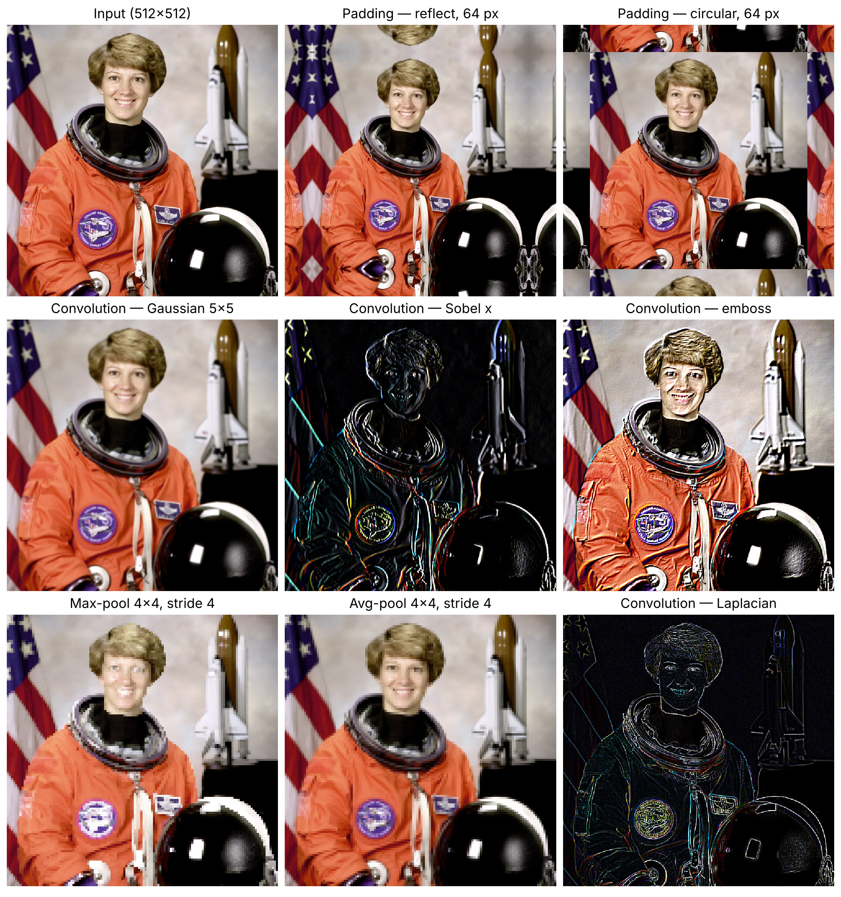
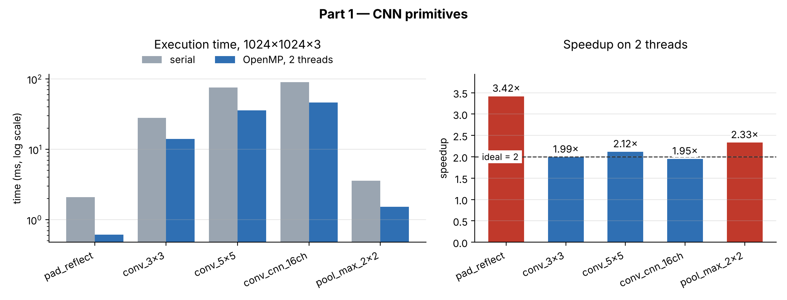

# Parallel CNN Primitives with OpenMP: Padding, Convolution and Pooling

**MTCS-103P — High Performance Computing Laboratory · Mini Project P1: Image Processing (2), Part 1**

**Submitted by:** B. Sai Buvann — Registration no. 26010303001  
**Institution:** Sri Sathya Sai Institute of Higher Learning  
**Implementation:** C99 + OpenMP, written from scratch  
**Repository:** <https://github.com/buvann-11/Parallel-Image-Processing-OpenMP>

---

## 1. Objective

Convolutional neural networks spend almost all their time in three operations:
**padding** the borders of a feature map, **convolving** it with learned filters,
and **pooling** it down to a smaller map. All three are data-parallel — the same
arithmetic applied independently to millions of values — which makes them
natural candidates for shared-memory parallelism.

This work implements the three operations in C, parallelises each with OpenMP,
proves that the parallel versions compute exactly what the serial versions
compute, and measures and explains how well each one scales.

## 2. Results at a glance

| Kernel | Serial (ms) | 2 threads (ms) | Speedup |
|---|---|---|---|
| Convolution 3×3 | 27.95 | 14.03 | 1.99× |
| Convolution 5×5 | 75.51 | 35.67 | 2.12× |
| CNN convolution, 16 channels | 90.38 | 46.35 | 1.95× |
| Max pooling 2×2 | 3.57 | 1.53 | 2.33× |
| Padding, reflect | 2.10 | 0.61 | 3.42× |

All outputs are bit-identical to the serial versions at every thread count, and
identical to an independent NumPy implementation.



## 3. Algorithms

### 3.1 Padding

Four border modes, all computed by mapping each padded coordinate `i` back to a
source index on an axis of length `n`:

| Mode | Source index | Typical use |
|---|---|---|
| zeros | — (constant 0) | default CNN padding |
| replicate | `clip(i, 0, n−1)` | image borders |
| circular | `i mod n` | periodic signals |
| reflect | `m = i mod (2n−2)`, then `m` or `2n−2−m` | smooth borders |

Using modular folding instead of a single reflection means pads **wider than the
axis itself** work correctly — a case `numpy.pad` rejects for `reflect`.

### 3.2 Convolution

```
y[n,f,p,q] = bias[f] + Σc Σi Σj  w[f,c,i,j] · x[n, c, p·s + i·d, q·s + j·d]
```

Batched, multi-channel (N×C×H×W), with stride `s`, dilation `d` and bias. A
**direct loop nest** is used rather than `im2col` + matrix multiply, so the
parallelism measured is ours and not a BLAS library's. The loop order puts the
**output column innermost** with the weight held in a register: at stride 1 the
input access is unit-stride and the compiler vectorises it into fused
multiply-adds. The input is padded once up front so the inner loops need no
bounds checks. The same engine provides depthwise image filters: box, Gaussian
5×5, Sobel x/y, Laplacian, sharpen and emboss.

### 3.3 Pooling

Max and average pooling with any window, stride and padding, plus global average
pooling. Instead of building a padded copy, each window is **clamped** to the
real input, which has three benefits:

- max pooling never returns a padding value (feature maps contain negative
  numbers, so a zero pad could wrongly win the maximum);
- average pooling divides by the number of real elements, so border outputs are
  unbiased;
- no padded buffer is allocated — a full pass over memory saved on a kernel that
  is already memory-bound.

## 4. Parallelisation

Every kernel exists twice: `<name>_serial()` with no OpenMP at all, and
`<name>_omp()`. Speedup is always measured against the directive-free version —
timing the parallel code on one thread would hide the OpenMP runtime's own cost.

```c
#pragma omp parallel for collapse(3) schedule(runtime) default(none) ...
for (n = 0; n < N; ++n)              /* batch                     */
  for (c = 0; c < C; ++c)            /* channel                   */
    for (oy = 0; oy < out_h; ++oy)   /* output row: one owner     */
```

- **Row ownership.** Each iteration writes exactly one output row and nothing
  else, so no two threads ever write the same element: no atomics, no critical
  sections and no locks anywhere on a hot path.
- **`collapse(3)`.** A single one-channel image has `N = C = 1`; collapsing the
  three loops still gives every thread a share of the rows.
- **No false sharing by design.** All buffers are 64-byte aligned, so a row
  boundary never splits a cache line between two threads.
- **`schedule(runtime)`** lets the schedule be changed without recompiling, for
  the scheduling experiments.

## 5. Performance

Strong scaling on a 1024×1024×3 input, best of repeated runs after a warm-up,
2-core x86-64 Linux machine, GCC `-O3`.



**Convolution scales ideally** (1.95–2.12× on 2 cores). It is compute-bound:
each output needs `k·k·C` multiply-adds, so the cores, not memory, are the
limit — these kernels will keep scaling on more cores.

**Padding and pooling appear superlinear** (3.42× and 2.33×, red). They do
almost no arithmetic and finish in 2–4 ms, so allocating and first-touching
the 12 MB output buffer is a large share of the measured time — and that page
work parallelises too. It is a property of the measurement, not the algorithm;
timing the arithmetic alone would show them memory-bound, below 2×.

**Loop schedule.** Because one iteration is a whole output row, these kernels
are insensitive to `dynamic` with chunk 1 (2.07× vs 2.16× for convolution 5×5).
A very large chunk (8192) is harmful instead: a 1024-row image has only ~1000
iterations, so one thread gets all the work (1.07×). For uniform rows `static`
is the right choice.

## 6. Correctness

| Check | Result |
|---|---|
| OpenMP output = serial output | exact for padding, convolution and max/average pooling |
| Output at 1, 2, 3 and 4 threads; static, dynamic and guided schedules | bit-identical |
| Known-value tests (all padding modes, 2×2 convolution sums, pooling) | pass |
| Global average pooling across thread counts | within 10⁻³ (summation order; documented) |
| ThreadSanitizer with Archer (OpenMP-aware race detector) | **no data races** |
| AddressSanitizer + UndefinedBehaviorSanitizer | clean |
| Independent NumPy implementation: padding, convolution, max pooling | **0** grey-level difference |
| Average pooling vs NumPy | ±1 grey level (float32 vs float64 rounding) |

The C test suite (27 tests, 41,119 assertions) runs on Linux, macOS and Windows
on every push, and can be run from the GUI's Test-suite tab with one click.


## 7. Conclusions

1. **Arithmetic intensity predicts scaling.** Convolution, with many operations
   per byte, scales ideally; padding and pooling are limited by memory.
2. **The right decomposition removes synchronisation.** Giving each thread whole
   output rows made atomics and locks unnecessary.
3. **Algorithm details matter for both speed and correctness.** Clamped pooling
   windows are faster *and* avoid a real correctness bug that padded copies
   would cause.
4. **Parallel code must be tested for exact equality.** Bit-identical output
   across thread counts and schedules is the practical proof that there is no
   data race.
