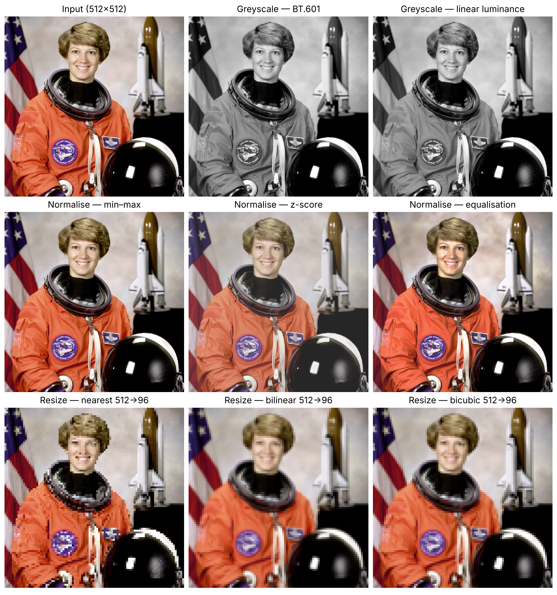
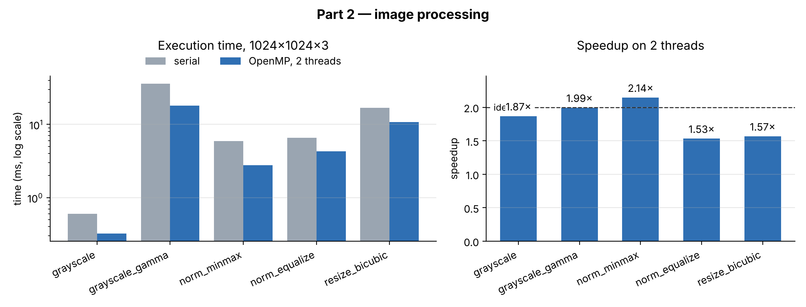

# Parallel Image Processing with OpenMP: Greyscale, Normalisation and Resize

**MTCS-103P — High Performance Computing Laboratory · Mini Project P1: Image Processing (2), Part 2**

**Submitted by:** M. Sai Praneeth — Registration no. 26010303004  
**Institution:** Sri Sathya Sai Institute of Higher Learning  
**Implementation:** C99 + OpenMP, written from scratch  
**Repository:** <https://github.com/buvann-11/Parallel-Image-Processing-OpenMP>

---

## 1. Objective

Before an image reaches a neural network it is usually converted to greyscale,
**normalised** to a standard range and **resized** to a fixed input size. Each
step touches every pixel, so on large images they are worth parallelising.

This work implements the three operations in C, parallelises each with OpenMP,
verifies the results exactly, measures how well each one scales and explains
why some scale better than others. It also provides a GUI for running the
operations and the test suite.

## 2. Results at a glance

| Kernel | Serial (ms) | 2 threads (ms) | Speedup |
|---|---|---|---|
| Greyscale, gamma-correct luminance | 36.12 | 18.12 | 1.99× |
| Greyscale, BT.601 | 0.60 | 0.32 | 1.87× |
| Normalise, min–max | 5.95 | 2.77 | 2.14× |
| Normalise, histogram equalisation | 6.57 | 4.29 | 1.53× |
| Resize, bicubic | 16.91 | 10.80 | 1.57× |

## 3. Algorithms

### 3.1 Greyscale

A weighted sum of red, green and blue, because the eye is most sensitive to
green: BT.601 (0.299, 0.587, 0.114), BT.709 (0.2126, 0.7152, 0.0722) and the
plain mean. A fourth method computes true **linear luminance**: sRGB values are
gamma-encoded (128 is about 21 % of the light of 255, not 50 %), so pixels are
linearised, weighted and re-encoded — two `powf` calls per pixel.

### 3.2 Normalisation

Every method needs a **global** statistic before any output pixel can be
written, so each runs as a parallel reduction followed by a parallel map:

| Method | Phase 1 — reduce | Phase 2 — map |
|---|---|---|
| min–max | global min and max | rescale to 0–255 |
| z-score | Σx and Σx² in one pass | rescale to mean 128, ±2σ |
| equalisation | 256-bin histogram | lookup table from the cumulative histogram |

### 3.3 Resize

Each output pixel is a weighted average of nearby input pixels (nearest,
bilinear, or bicubic with Keys *a* = −0.5), sampled at pixel centres as in
Pillow and OpenCV. Two design points:

- **Separable, two passes.** Horizontal then vertical, so a bicubic resize does
  4 + 4 taps per pixel instead of 4 × 4 — 4× less arithmetic before any
  parallelism.
- **Anti-aliasing.** When shrinking, the kernel is widened by the scale factor
  so every input pixel contributes; otherwise fine detail turns into moiré.

## 4. Parallelisation

Every kernel has a `_serial()` version with no OpenMP and an `_omp()` version;
speedup is measured against the directive-free one.

- **Greyscale** — one `parallel for` over pixels; each thread writes only its
  own pixels.
- **Min–max** — `reduction(min:lo) reduction(max:hi)`.
- **Z-score** — two `reduction(+:)` sums in a single pass over memory.
- **Equalisation** — each thread fills a **private histogram** padded to whole
  64-byte cache lines; the copies are merged afterwards. A shared histogram with
  `#pragma omp atomic` makes every thread fight over the same cache lines and runs
  slower than serial.
- **Resize** — the horizontal and vertical passes are separate parallel loops;
  the implicit barrier between them is the only synchronisation needed. The
  small weight tables are deliberately built serially.

## 5. Performance

Strong scaling on a 1024×1024×3 input, best of repeated runs after a warm-up,
2-core x86-64 Linux machine, GCC `-O3`.

**Arithmetic intensity predicts scalability.** Gamma-correct greyscale does
expensive arithmetic per pixel and reaches the ideal 1.99×. Plain greyscale
does one multiply-add per byte loaded; it is memory-bound and reaches 1.87×.

**Serial phases cap the rest.** Equalisation (1.53×) has a serial histogram
merge and table build; resize (1.57×) has serial weight tables and a barrier.
The Karp–Flatt metric, `e = (1/S − 1/p)/(1 − 1/p)`, measures the serial
fraction directly: *e* ≈ 0.31 for equalisation and 0.28 for resize, matching
those serial sections in the code.

**Chunk size is not a detail.** With `schedule(dynamic)` OpenMP's default chunk
is 1, so every pixel passes through the runtime's dispatcher:

| Kernel | `static` | `dynamic`, chunk 1 | `dynamic`, chunk 8192 |
|---|---|---|---|
| Greyscale | 1.32× | **0.01×** | 1.37× |
| Normalise, min–max | 2.18× | **0.02×** | 2.02× |
| Normalise, equalisation | 1.50× | **0.02×** | 0.97× |
| Resize, bicubic | 1.68× | 1.63× | **0.90×** |

Per-pixel loops become 100× *slower* at chunk 1; resize, whose iterations are
whole rows, instead starves at chunk 8192. The chunk must match the loop
granularity, and for uniform work `static` is the right choice.

**Baselines matter.** An early version reported 15× on 2 cores. The cause: the
"serial" baseline was `#pragma omp parallel for if(0)`, and GCC still runs the
OpenMP loop machinery when the condition is false. Directive-free serial code
fixed the measurement.

## 6. Correctness

| Check | Result |
|---|---|
| OpenMP output = serial output | exact, every method |
| Output at 1–4 threads; static, dynamic and guided | bit-identical |
| Independent NumPy implementation | **0** grey-level difference for greyscale, min–max, equalisation and nearest resize; ±1 for bilinear and bicubic |
| ThreadSanitizer with Archer; AddressSanitizer | no races; clean |
| Linux, macOS and Windows on every push | pass |

Two real bugs were found and fixed:

- **Resize.** Nearest-neighbour downscaling disagreed with NumPy on 0.6 % of
  pixels: in `float32`, `floor((p + 0.5) · scale)` landed on the wrong side of an
  integer for ratios like 256/97. Sample positions are now computed in `double`.
- **Compiler bug in equalisation.** On macOS, Apple clang 21 at `-O2`/`-O3`
  dropped counts in the per-thread histogram loop under `schedule(runtime)` —
  27,648 pixels gave only 19,633 counts — so equalisation differed from the
  serial version. GCC and `-O0`/`-O1` were correct. Writing each increment
  through a `volatile` pointer avoids the faulty optimisation at no measurable
  cost.

## 7. Graphical interface

`gui/app.py` uses only the Python standard library. The **Operations** tab loads
any image (PPM, PNG, JPEG, BMP, TGA), runs an operation with a chosen thread
count and schedule, and shows input, output, serial time, parallel time and
speedup side by side.

The **Test suite** tab runs each test stage with one click — C test suite,
image-format tests, NumPy cross-check, a thread-count sweep that hashes every
output, and a quick benchmark — with a live PASS/FAIL badge for each.

## 8. Conclusions

1. **Arithmetic intensity decides scaling** — expensive per-pixel arithmetic
   scales ideally, memory-bound maps do not.
2. **Serial phases set the ceiling** (Amdahl), and Karp–Flatt measures them.
3. **Chunk size must match loop granularity** — a wrong choice cost 100×.
4. **Algorithms come first** — the separable resize saves 4× arithmetic, more
   than a second core provides.
5. **Exact serial = parallel testing finds real bugs**, including one in the
   compiler.
